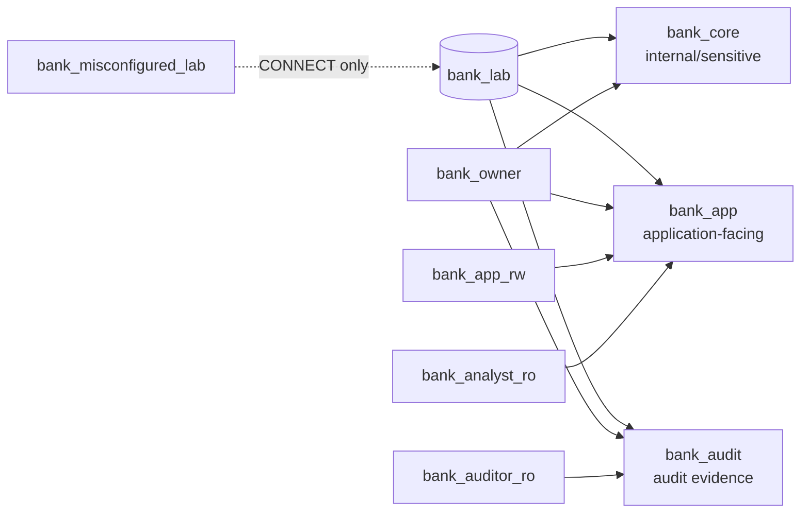
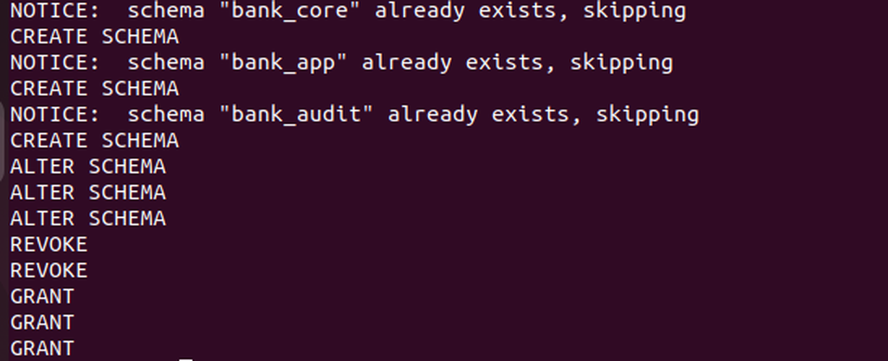
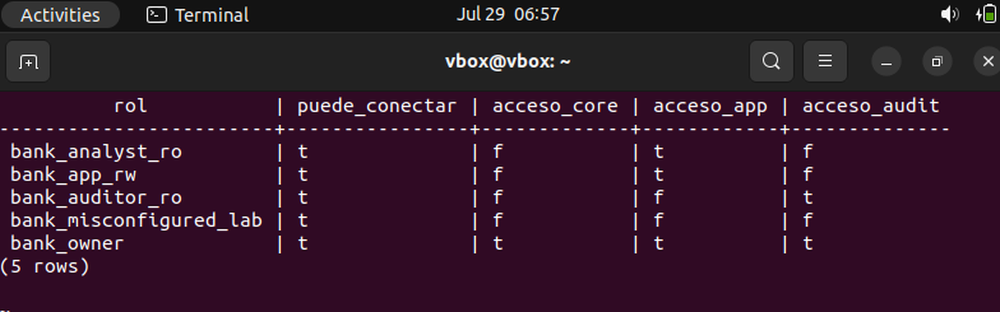
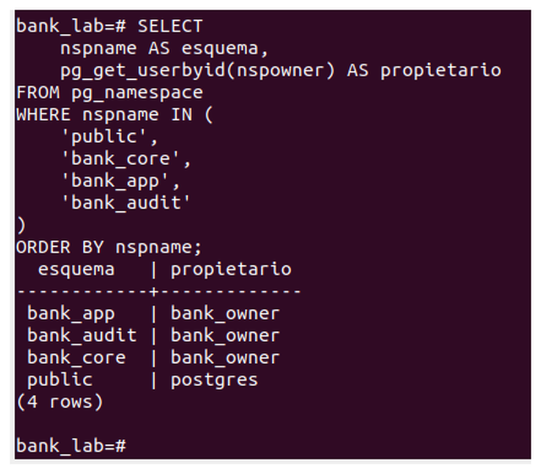

# Lab 11.2 — PostgreSQL Schema Isolation and Permission Baseline

## Summary

This lab builds a least-privilege authorization baseline inside the local PostgreSQL database `bank_lab`. It separates internal, application and audit objects into independent schemas, assigns a technical owner and grants each operational role only the schema access required for its function.

The lab is performed in a controlled Ubuntu environment with synthetic names and no external targets, real customer data, public IP exposure or production credentials.

## Objectives

- Remove global object-creation rights from the default `public` schema.
- Create the `bank_core`, `bank_app` and `bank_audit` security zones.
- Assign ownership to the non-application role `bank_owner`.
- Establish a closed permission baseline before granting access.
- Grant `CONNECT` and `USAGE` independently.
- Verify the effective role-to-schema access matrix.

## Security model



## Role baseline

| Role | Intended function | Schema access |
|---|---|---|
| `bank_owner` | Technical owner of database objects | `bank_core`, `bank_app`, `bank_audit` |
| `bank_app_rw` | Application role | `bank_app` |
| `bank_analyst_ro` | Read-only analyst role | `bank_app` |
| `bank_auditor_ro` | Audit review role | `bank_audit` |
| `bank_misconfigured_lab` | Controlled negative-test role | None |

## Key result

```text
CONNECT != USAGE != SELECT
```

This stage proves the first boundary: all lab roles can connect to `bank_lab`, but only explicitly authorized roles can reference each schema. No table-level `SELECT`, `INSERT`, `UPDATE` or `DELETE` privilege is granted in this stage.

## Evidence

### 1. Baseline execution

The script completed the schema, ownership and permission operations. Existing schemas generated idempotent `NOTICE` messages rather than failures, and the terminal confirmed the `ALTER SCHEMA`, `REVOKE` and `GRANT` operations.



### 2. Effective role-to-schema matrix

The permission matrix confirms the expected least-privilege model:

- The application and analyst roles can use only `bank_app`.
- The auditor can use only `bank_audit`.
- The negative-test role can connect but cannot use any protected schema.
- The technical owner can use all three schemas.



### 3. Schema ownership validation

The corrected inventory confirms that all three protected schemas exist and are owned by `bank_owner`, while the default `public` schema remains owned by `postgres`.



## Repository structure

```text
11-02-postgresql-schema-isolation-permission-baseline/
├── README.md
├── docs/
│   ├── COMMANDS.md
│   └── FINDINGS.md
├── scripts/
│   ├── apply_baseline.sql
│   └── verify_baseline.sql
└── evidence/
    ├── lab11_02_contact_sheet.jpg
    ├── source/
    │   └── bank_lab_source.docx
    └── screenshots/
        ├── 01-baseline-execution.png
        ├── 02-role-schema-access-matrix.png
        └── 03-schema-ownership-validation.png
```

## Reproduction

```bash
cd 11-02-postgresql-schema-isolation-permission-baseline
sudo -iu postgres psql -d bank_lab -f scripts/apply_baseline.sql
sudo -iu postgres psql -d bank_lab -f scripts/verify_baseline.sql
```

## Findings

The baseline is technically validated. The effective permissions match the intended role model and demonstrate that database connection rights and schema usage rights are independent controls.

See [`docs/FINDINGS.md`](docs/FINDINGS.md) for the concise security interpretation.

## Next stage

Lab 11.3 will create tables and views and test positive and negative access cases to demonstrate that schema `USAGE` does not grant table `SELECT`.

## Reference

Conceptual basis: role-based access control, object privileges, grants/revocations and minimum necessary privileges as discussed in *Database and Application Security* by R. Sarma Danturthi.

## Status

**Completed — baseline applied and evidence validated.**
