# Lab 11.3 — PostgreSQL Table Privileges and Least Privilege Enforcement

## Objective
Demonstrate how PostgreSQL applies **least privilege** at table level after schema isolation has already been established.

This lab proves the following layered model:

```text
CONNECT to the database
        ≠
USAGE on the schema
        ≠
SELECT / INSERT / UPDATE / DELETE on the table
```

## Scope
The lab builds three tables across three schemas:

- `bank_core.customer_accounts` → sensitive customer data
- `bank_app.payment_requests` → application working table
- `bank_audit.access_events` → audit records

Roles tested:

- `bank_app_rw`
- `bank_analyst_ro`
- `bank_auditor_ro`
- `bank_misconfigured_lab`
- `bank_owner`

## Explanatory diagram

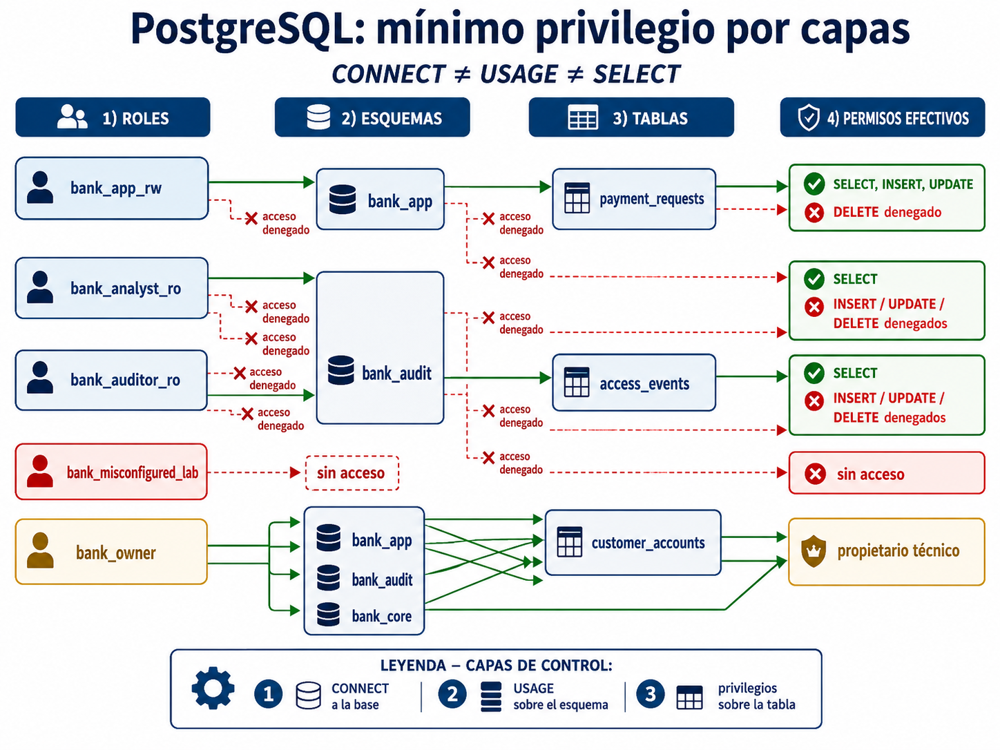

## Architecture summary

| Role | Allowed access | Denied access |
|---|---|---|
| `bank_app_rw` | `SELECT`, `INSERT`, `UPDATE` on `bank_app.payment_requests` | `DELETE`; all direct access to `bank_audit` and `bank_core` |
| `bank_analyst_ro` | `SELECT` on `bank_app.payment_requests` | `INSERT`, `UPDATE`, `DELETE`; all direct access to `bank_core` |
| `bank_auditor_ro` | `SELECT` on `bank_audit.access_events` | access to `bank_app` and `bank_core` |
| `bank_misconfigured_lab` | none | all tested paths |
| `bank_owner` | all three schemas and all three tables | none |

## Evidence walkthrough

### 1) Table creation baseline
The three tables were created and seeded with sample data. General access was revoked from `PUBLIC` and the operational roles.

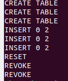

### 2) Ownership validation
The three tables belong to `bank_owner`, confirming separation between administrative execution and technical object ownership.

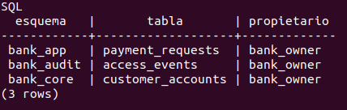

### 3) `USAGE` vs `SELECT`
This matrix confirms that being able to use a schema does not automatically grant read access to the tables inside it.

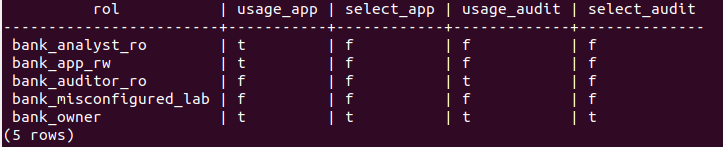

### 4) Real denial before grants
`bank_app_rw` can enter `bank_app`, but before table grants it receives `permission denied for table payment_requests`.

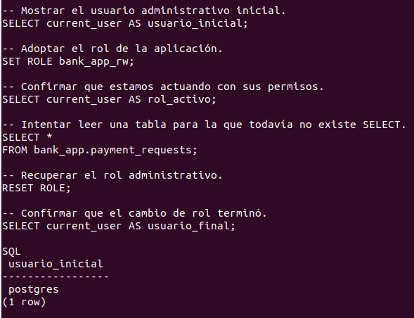
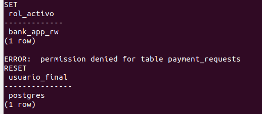

### 5) Grant execution and least-privilege matrix
Table permissions were granted per function and then validated through a role-based matrix.

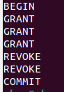
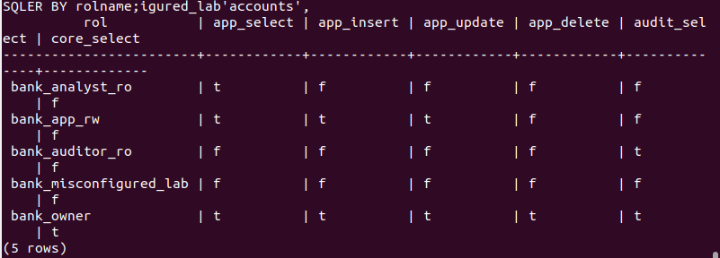

### 6) `bank_app_rw` allowed operations
The application role can read, insert and update `payment_requests` but not delete rows.

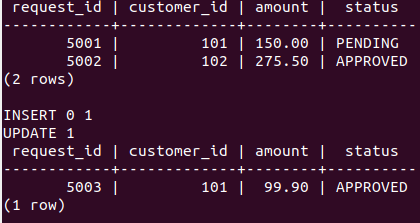
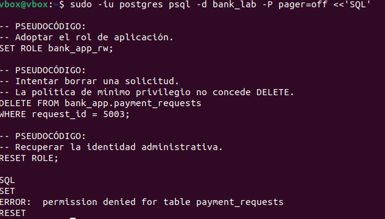

### 7) `bank_analyst_ro` read-only behavior
The analyst can query the table but receives a permission error when attempting to insert.

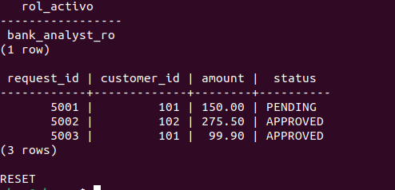
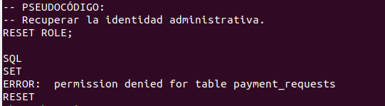

### 8) `bank_auditor_ro` audit-only behavior
The auditor can read `access_events` and is blocked at the schema layer when attempting to reach `bank_app`.

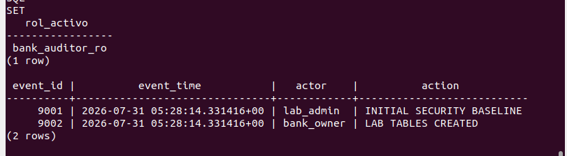
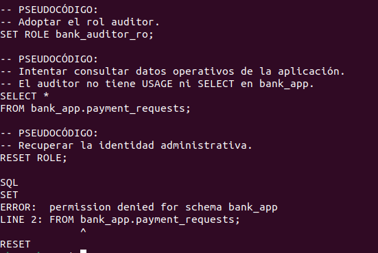

### 9) Sensitive data isolation in `bank_core`
No operational role can traverse `bank_core` or read `customer_accounts`. The protection is enforced at both schema and table level.

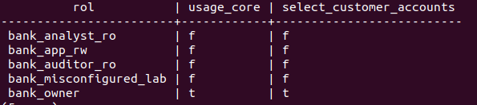
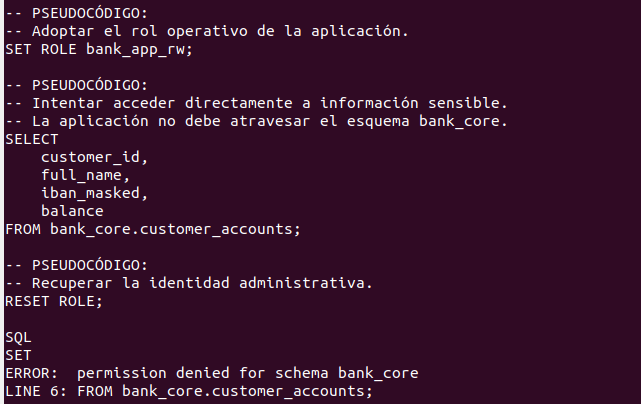

## Key findings

- The security model is enforced in layers: **database → schema → table → data**.
- PostgreSQL enforces real runtime denials, not only catalog-level metadata.
- Sensitive data in `bank_core` remains isolated from application, analyst and auditor roles.
- `bank_owner` acts as the technical owner while `postgres` acts only as the administrative executor.

## Repository structure

```text
11-03-postgresql-table-privileges-least-privilege/
├── README.md
├── docs/
│   ├── COMMANDS.md
│   └── FINDINGS.md
├── scripts/
│   ├── create_tables.sql
│   ├── grant_permissions.sql
│   └── verify_access.sql
└── evidence/
    ├── contact-sheet.png
    ├── diagrams/
    │   └── 01-postgresql-least-privilege-flow.png
    ├── screenshots/
    │   ├── 01-table-creation-baseline.png
    │   ├── 02-table-ownership-validation.png
    │   ├── 03-usage-vs-select-matrix.png
    │   ├── 04-real-select-denial-bank-app-rw.png
    │   ├── 05-real-select-denial-bank-app-rw-result.png
    │   ├── 06-grant-script-execution.png
    │   ├── 07-least-privilege-permission-matrix.png
    │   ├── 08-bank-app-rw-allowed-operations.png
    │   ├── 09-bank-app-rw-delete-denied.png
    │   ├── 10-analyst-select-allowed.png
    │   ├── 11-analyst-insert-denied.png
    │   ├── 12-auditor-audit-select-allowed.png
    │   ├── 13-auditor-app-access-denied.png
    │   ├── 14-sensitive-core-access-matrix.png
    │   └── 15-sensitive-core-access-denied.png
    └── source/
        └── bank7_source.docx
```

## Conclusion
This lab shows how PostgreSQL can enforce a realistic **least-privilege access model** through role separation, schema isolation and explicit table-level grants. The result is a controlled environment where each role can perform only the operations strictly required by its function.
